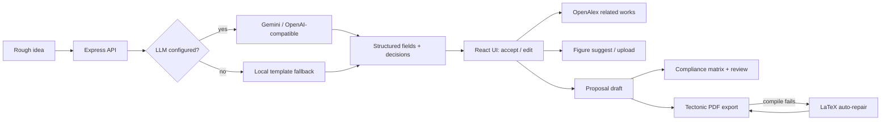
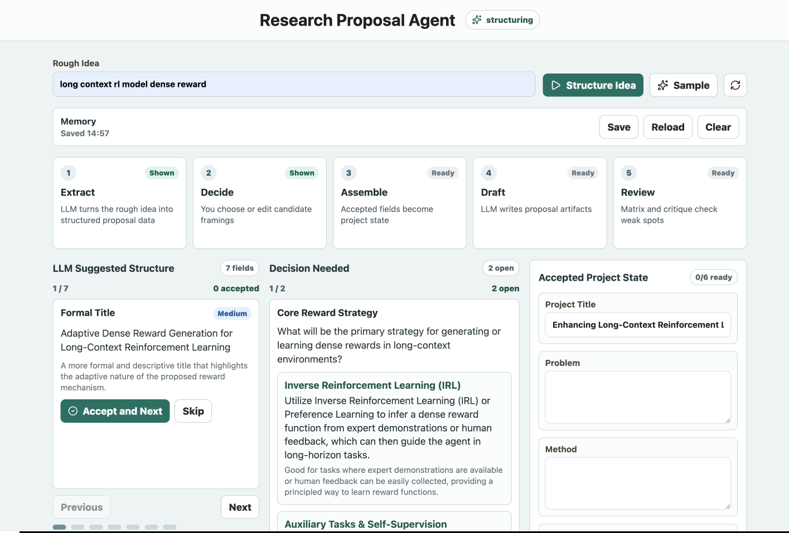
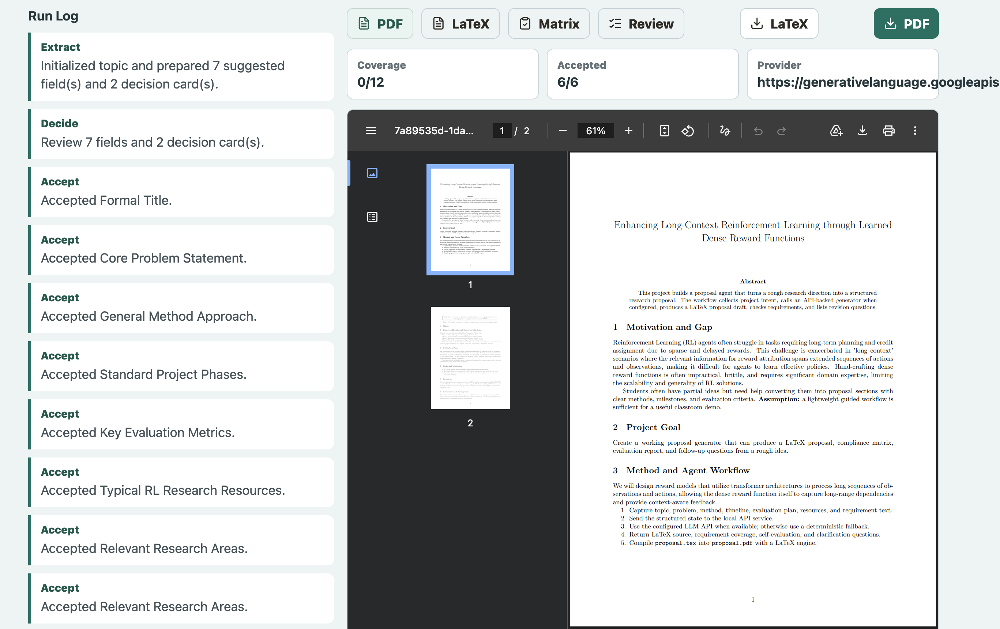

# Research Mentor

A local web app that turns a rough CS research idea into a reviewed, compile-ready LaTeX proposal PDF.

## Overview

Writing a research proposal means structuring a vague idea into problem, method, timeline, evaluation, and references, then checking that the draft actually covers those pieces. Research Mentor walks through that workflow in the browser: it structures the idea, lets you accept or override decisions, pulls real papers from OpenAlex, drafts LaTeX, compiles a PDF, and can run a second LLM as an independent reviewer.

## How it works



1. Enter a rough idea. `POST /api/agent/start` returns suggested fields and decision cards (LLM or local fallback).
2. Accept, skip, or edit suggestions; selected OpenAlex papers become the references list.
3. Optionally add LaTeX figures or uploaded images.
4. `POST /api/proposal` returns LaTeX, a requirement compliance matrix, and an evaluation report.
5. `POST /api/export/pdf` compiles with Tectonic; on failure the client can call `POST /api/repair` and retry.
6. `POST /api/review` can score the draft with a separate reviewer model when configured.

## What it does

Working features in this repo:

- **Idea structuring** — topic in, structured problem/method/timeline/evaluation/resources out, plus selectable decision cards
- **Related works** — OpenAlex search (no API key); checkbox-select papers into the proposal references
- **Figures** — model-suggested compile-safe LaTeX figures, or upload your own image into the PDF
- **Draft + review artifacts** — full LaTeX proposal, compliance matrix against the built-in section checklist, and evaluation notes
- **PDF export** — server-side Tectonic compile, with one auto-repair pass if the first compile fails
- **Optional second reviewer** — separate `LLM_REVIEW_*` provider for an NSF-style score and suggested edits
- **Local fallback** — runs without any LLM key using deterministic templates
- **Browser memory** — save/reload workspace state in `localStorage`

Sample run (with or without an API key):

1. Open the app and click **Sample**, or type your own rough idea and click **Structure Idea**.
2. Accept or edit the suggested fields and decision cards; refresh Related Works and check papers to cite.
3. Optionally click **Suggest figure** (or upload an image).
4. Click **Generate proposal**, inspect the PDF / LaTeX / Matrix / Review tabs, then **Get reviewer feedback** if a reviewer model is configured.
5. Download the `.tex` or compiled PDF from the artifact panel.





> Replace these screenshots with fresh captures of the current Research Mentor UI if the ones in `docs/assets/` look out of date.

## Tech stack

| Layer | Tech |
| --- | --- |
| Frontend | React 19, Vite 8, lucide-react |
| Backend | Node.js (Express 5) |
| LLMs | Gemini or any OpenAI-compatible chat API (optional) |
| Literature | [OpenAlex](https://openalex.org/) Works API |
| PDF | [Tectonic](https://tectonic-typesetting.github.io/) LaTeX engine |

## Getting started

**Requirements:** Node.js 18.18+, npm, and a Tectonic binary on your `PATH` (or at `server/bin/tectonic`, or set `TECTONIC_PATH`). PDF export needs Tectonic; the rest of the UI/API works without it.

```bash
git clone https://github.com/rithwik1405/CS222-Spring-Final-Project.git
cd CS222-Spring-Final-Project
npm install
cp .env.example .env   # optional — fill in LLM keys for real generation
npm run dev
```

Open [http://127.0.0.1:5174](http://127.0.0.1:5174). The Vite dev server proxies `/api` to the Express API on port `8787`.

Useful scripts:

| Command | What it runs |
| --- | --- |
| `npm run dev` | API + Vite together |
| `npm run dev:api` | Express only (`PORT`, default 8787) |
| `npm run dev:web` | Vite only |
| `npm run build` | Production frontend build |
| `npm start` | API only |

Without `LLM_API_KEY` / `LLM_API_URL`, `/api/health` reports `local-fallback` and the server still returns template suggestions and a draft proposal.

## Project structure

```text
.
├── src/App.jsx                 # React workflow UI
├── src/index.css
├── server/index.js             # Express routes
├── server/proposalGenerator.js # LLM prompts, fallback, review, repair
├── server/literature.js        # OpenAlex search
├── server/pdfExport.js         # Tectonic compile + LaTeX sanitizers
├── docs/assets/                # README screenshots
├── .env.example
├── package.json
└── vite.config.js
```

## Credits

Solo project by [Rithwik Kondoju](https://github.com/rithwik1405).

The first commit in this repo started from the course’s optional starter app; the Research Mentor workflow (OpenAlex related works, figures, multi-provider review, LaTeX repair/sanitizers, NSF-oriented prompting, and the current UI) was built on top of that scaffold.

## Context

Built for CS222 at UC Riverside, Spring 2026.
